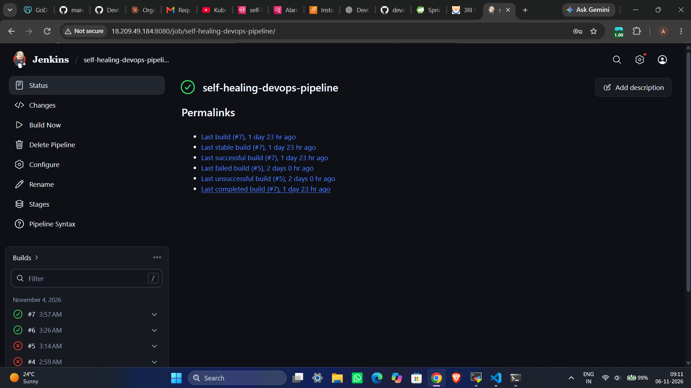
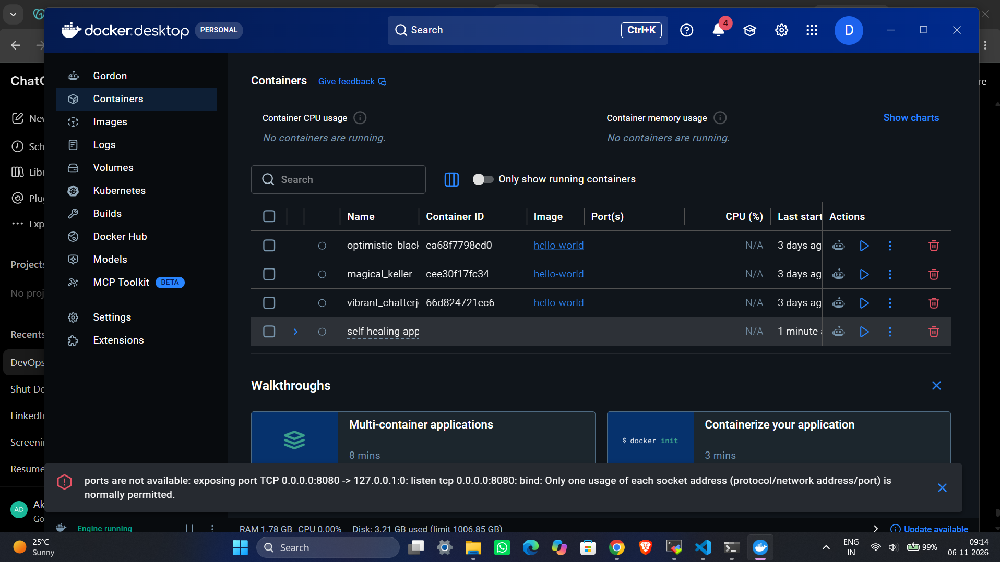
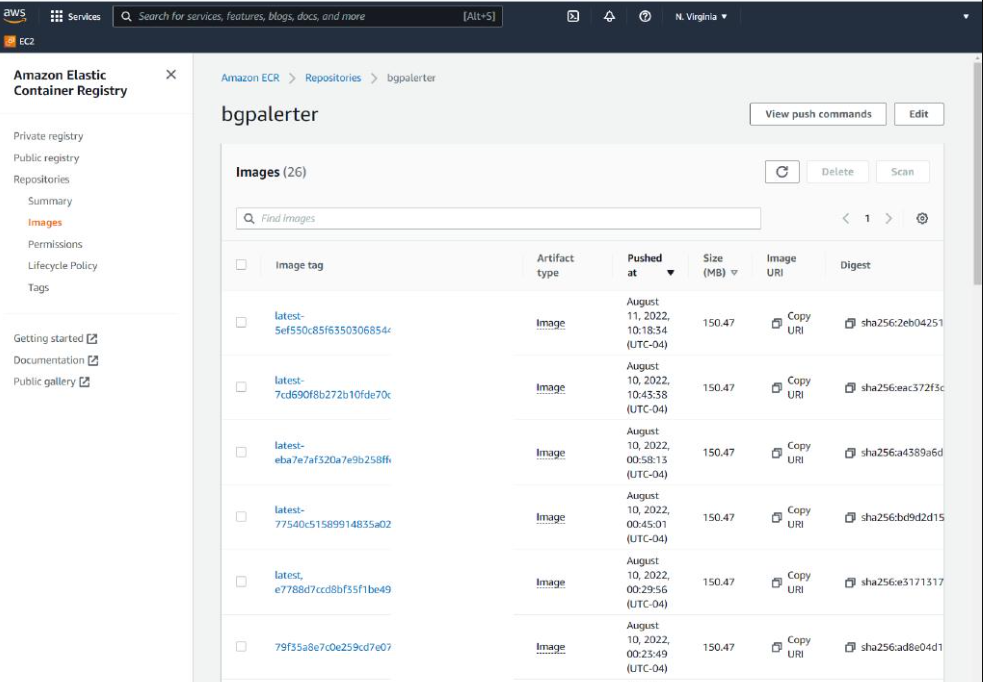
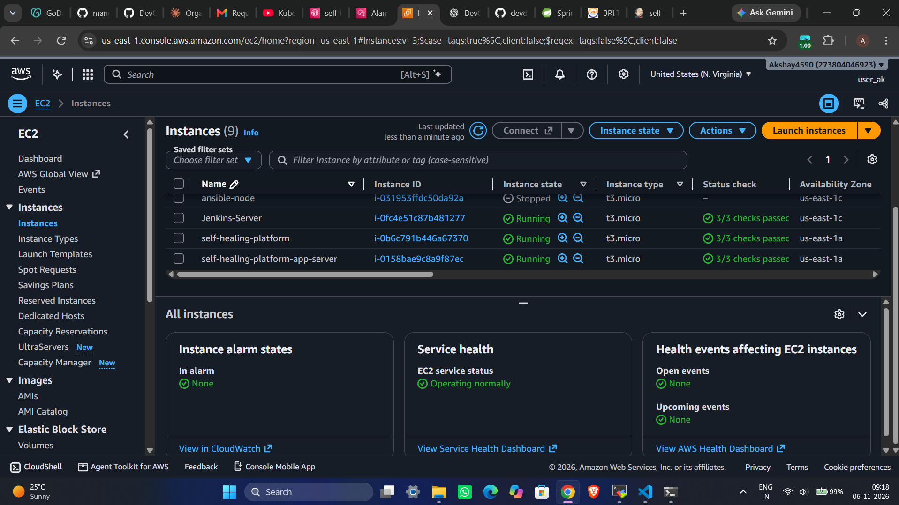
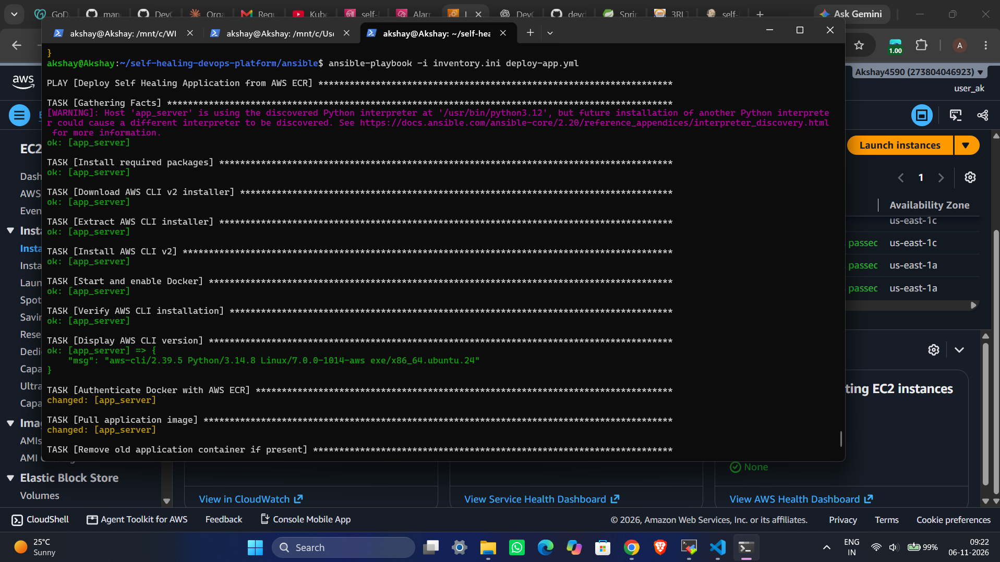
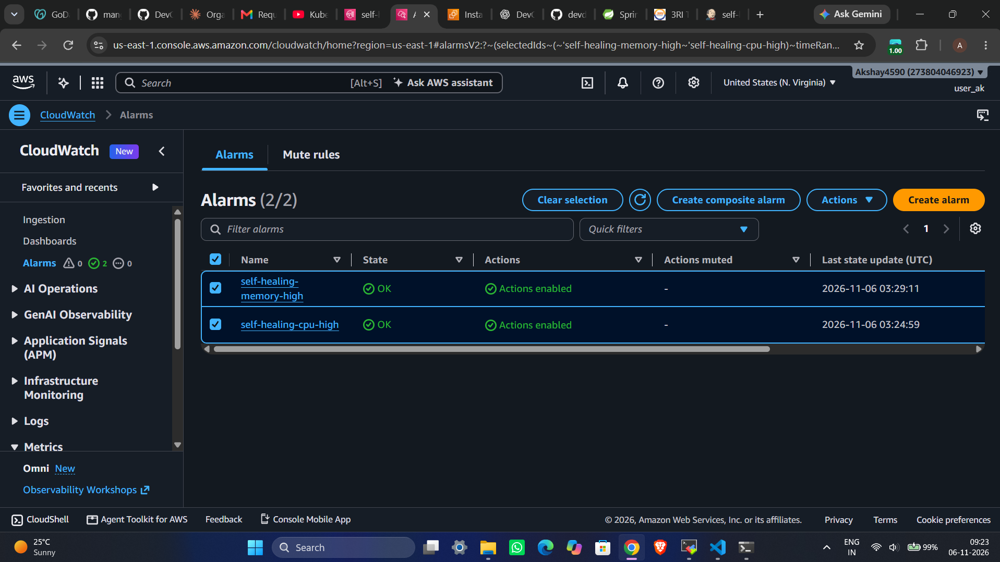
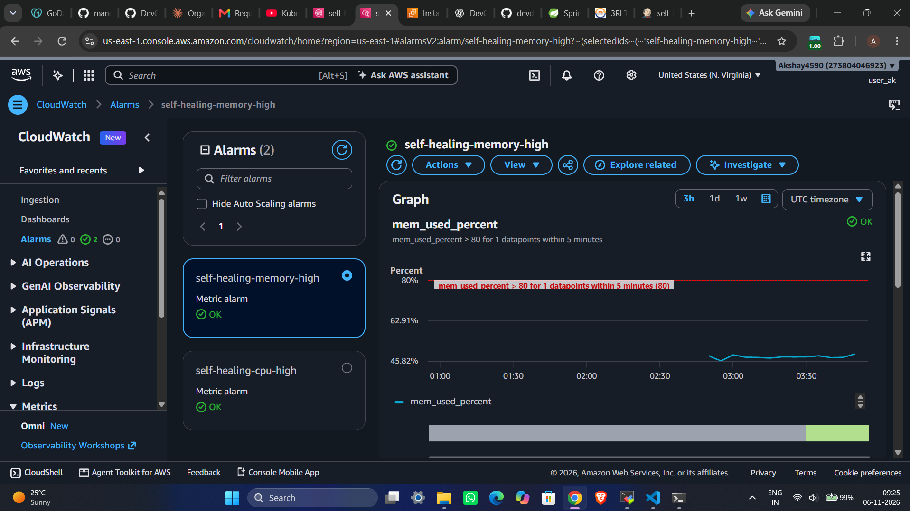
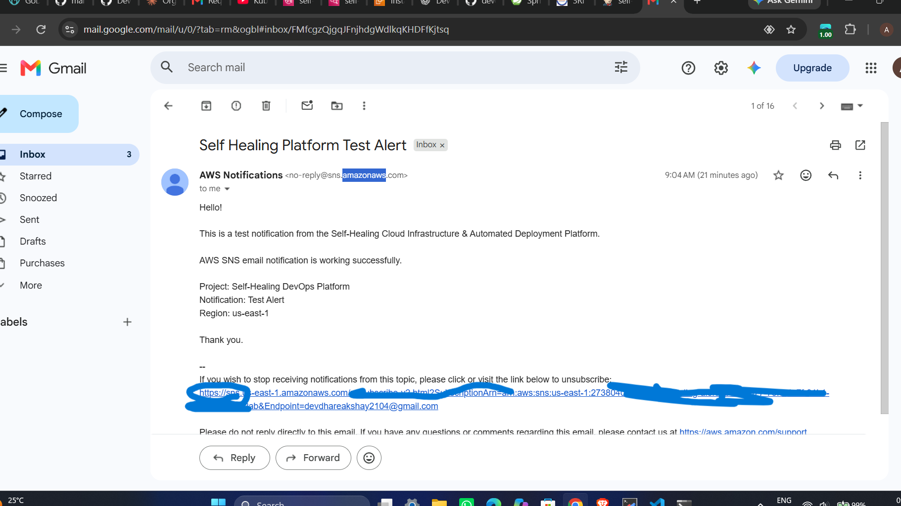
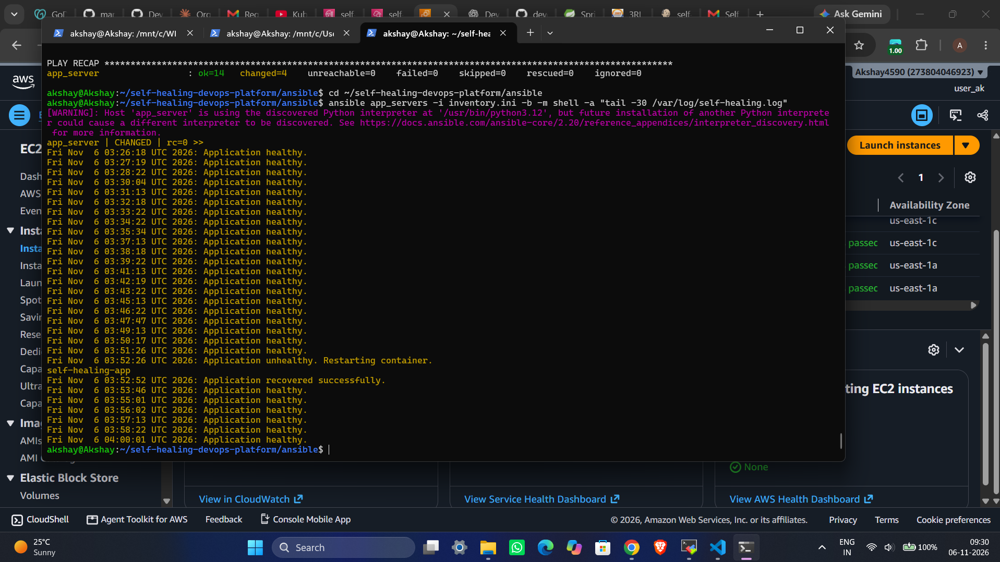

# 🚀 Self-Healing Cloud Infrastructure & Automated Deployment Platform:

<p align="center">
  <b>An Automated DevOps Platform for CI/CD, Cloud Infrastructure, Deployment, Monitoring and Self-Healing</b>
</p>

## 📌 Project Overview:

The **Self-Healing Cloud Infrastructure & Automated Deployment Platform** is a cloud-based DevOps project designed to automate application building, containerization, deployment, infrastructure provisioning, monitoring, and application recovery.

This project integrates AWS services and DevOps tools to reduce manual intervention and improve application availability.

Jenkins automates CI/CD, Docker containerizes the application, Amazon ECR stores container images, Terraform provisions AWS infrastructure, and Ansible automates deployment and configuration.

Amazon CloudWatch monitors infrastructure metrics, while a custom self-healing mechanism detects application failures and automatically restarts the Docker container.

## 🎯 Project Objectives:

- Automate application build and deployment.
- Implement Jenkins-based CI/CD.
- Containerize the Spring Boot application using Docker.
- Store Docker images in Amazon ECR.
- Provision AWS infrastructure using Terraform.
- Automate deployment using Ansible.
- Monitor EC2 resources using CloudWatch.
- Implement automatic application recovery.
- Send email notifications using Amazon SNS.

## 🛠️ Technologies Used

| Category | Technologies |
|---|---|
| Programming Language | Java 21 |
| Framework | Spring Boot |
| Build Tool | Maven |
| CI/CD | Jenkins |
| Containerization | Docker, Docker Compose |
| Container Registry | Amazon ECR |
| Cloud Platform | AWS |
| Infrastructure as Code | Terraform |
| Configuration Management | Ansible |
| Monitoring | Amazon CloudWatch |
| Notifications | Amazon SNS |
| Automation | Bash, systemd |
| Version Control | Git, GitHub |
| Operating System | Ubuntu, Windows 11 |

## 🏗️ Project Architecture

```text
                 DEVELOPER
                     |
                     v
                GITHUB REPO
                     |
                     v
             JENKINS CI/CD PIPELINE
                     |
             +-------+-------+
             |       |       |
             v       v       v
           Maven   Testing  Docker
                             |
                             v
                       AMAZON ECR
                             |
                             v
                  TERRAFORM PROVISIONING
                             |
                             v
                     AWS INFRASTRUCTURE
                             |
                             v
                    EC2 APPLICATION SERVER
                             |
                             v
                    ANSIBLE DEPLOYMENT
                             |
                             v
                    DOCKER CONTAINER
                             |
                             v
                    SPRING BOOT APP
                             |
                 +-----------+-----------+
                 |                       |
                 v                       v
             CLOUDWATCH             SELF-HEALING
             MONITORING             AUTOMATION
                 |                       |
                 v                       v
              SNS EMAIL              CONTAINER
             NOTIFICATION             RECOVERY
```

## ⚙️ Project Implementation

### Phase 1 – Spring Boot Application

- Developed a Spring Boot application using Java 21 and Maven.
- Created application health-check endpoints.
- Configured Spring Boot Actuator.

**Application endpoints:**

| Endpoint | Description |
|---|---|
| `/` | Application running message |
| `/health` | Application health information |
| `/version` | Application version |
| `/actuator/health` | Spring Boot health check |

### Phase 2 – Docker & Jenkins CI/CD

- Created Dockerfile for application containerization.
- Configured Jenkins pipeline.
- Integrated Maven build and testing.
- Automated Docker image creation.
- Configured application deployment and health checks.

### Phase 3 – AWS ECR Integration

- Created a private Amazon ECR repository.
- Configured IAM permissions for Jenkins EC2.
- Integrated Docker with Amazon ECR.
- Automated Docker image tagging and pushing.

**ECR Repository:**

```text
273804046923.dkr.ecr.us-east-1.amazonaws.com/self-healing-app
```

### Phase 4 – Terraform Infrastructure Provisioning

Provisioned AWS infrastructure using Terraform.

**Resources created:**

- VPC
- Public Subnet
- Internet Gateway
- Public Route Table
- Route Table Association
- Security Group
- IAM Role
- IAM Policy Attachments
- IAM Instance Profile
- EC2 Application Server

**Network configuration:**

| Resource | Configuration |
|---|---|
| VPC CIDR | `10.0.0.0/16` |
| Public Subnet | `10.0.1.0/24` |
| Availability Zone | `us-east-1a` |
| EC2 Instance | `t3.micro` |
| Root Volume | 12 GB gp3 |
| AWS Region | `us-east-1` |

**Terraform commands:**

```bash
terraform init
terraform fmt
terraform validate
terraform plan
terraform apply
terraform output
```

### Phase 5 – Ansible Configuration & Deployment

Used Ubuntu WSL as the Ansible control node and AWS EC2 as the managed node.

**Implemented tasks:**

- Connected to EC2 using SSH.
- Installed Docker.
- Started and enabled Docker service.
- Installed AWS CLI v2.
- Authenticated with Amazon ECR using IAM role.
- Pulled Docker images from ECR.
- Deployed the Spring Boot application.
- Verified application health.

**Ansible commands:**

```bash
ansible app_servers -i inventory.ini -m ping

ansible-playbook -i inventory.ini install-docker.yml

ansible-playbook -i inventory.ini deploy-app.yml
```

### Phase 6 – AWS CloudWatch Monitoring

Integrated CloudWatch Agent with the application EC2 instance.

**Metrics monitored:**

- CPU utilization through EC2 metrics.
- Memory utilization through CloudWatch Agent.
- Disk utilization through CloudWatch Agent.

**CloudWatch namespace:** `CWAgent`

### Phase 7 – Self-Healing Automation

Implemented automated application health monitoring and Docker container recovery using Bash scripting, systemd, and Ansible.

**Working process:**

1. Systemd timer executes the health-check service every minute.
2. Bash script checks the Spring Boot Actuator endpoint.
3. If the application is unhealthy, Docker container restart is triggered.
4. Script waits for application startup.
5. Application health is checked again.
6. Recovery information is stored in `/var/log/self-healing.log`.

**Health-check endpoint:**

```text
http://127.0.0.1:8080/actuator/health
```

**Recovery test result:**

- Application failure was deliberately simulated.
- Self-healing script detected the unhealthy application.
- Docker container restart was triggered automatically.
- Application recovered successfully.
- Subsequent health checks confirmed the application was healthy.

### Phase 8 – CloudWatch Alarms & SNS Notifications

Integrated Amazon SNS email notifications.

**SNS configuration:**

- Topic: `self-healing-alerts`
- Protocol: Email
- Email subscription: Confirmed
- Test notification: Successfully received

**CloudWatch alarm configuration:**

| Alarm | Metric | Threshold |
|---|---|---|
| self-healing-cpu-high | CPUUtilization | Greater than 80% |
| self-healing-memory-high | mem_used_percent | Greater than 80% |

CloudWatch alarm configuration and actual alarm states should be verified in AWS before claiming both alarms are fully operational.

## 📸 Project Screenshots

The following screenshots demonstrate the actual implementation and execution of the project.

## 📸 Project Screenshots

### 1. Jenkins CI/CD Pipeline



### 2. Docker Containerization



### 3. Amazon ECR Repository



### 4. AWS EC2 Infrastructure



### 5. Ansible Automated Deployment



### 6. AWS CloudWatch Monitoring



### 7. CloudWatch Alarms



### 8. Amazon SNS Email Notification



### 9. Self-Healing Application Recovery



## 📁 Project Structure

```text
self-healing-devops-platform/
│
├── application/
│   └── self-healing-app/
│       ├── src/
│       ├── Dockerfile
│       ├── Jenkinsfile
│       ├── pom.xml
│       └── docker-compose.yml
│
├── terraform/
│   ├── provider.tf
│   ├── variables.tf
│   ├── main.tf
│   ├── outputs.tf
│   └── .terraform.lock.hcl
│
├── ansible/
│   ├── inventory.ini
│   ├── install-docker.yml
│   ├── deploy-app.yml
│   ├── cloudwatch-agent.yml
│   └── self-healing.yml
│
├── screenshots/
│   ├── jenkins.png
│   ├── docker.png
│   ├── ecr.png
│   ├── ec2.png
│   ├── ansible.png
│   ├── cloudwatch.png
│   ├── alarms.png
│   ├── sns-email.png
│   └── self-healing.png
│
├── .gitignore
└── README.md
```

*The structure above represents the intended repository layout. Keep only files that exist in your actual repository.*

## 🔍 Useful Verification Commands

```bash
# Check application health
curl http://localhost:8080/actuator/health

# List running containers
docker ps

# View application logs
docker logs self-healing-app

# Check self-healing timer
systemctl list-timers self-healing.timer

# View self-healing logs
tail -20 /var/log/self-healing.log

# Check CloudWatch Agent
sudo /opt/aws/amazon-cloudwatch-agent/bin/amazon-cloudwatch-agent-ctl -a status
```

## 🔐 Security Considerations

- Use IAM roles instead of hardcoding AWS access keys on EC2.
- Never upload private SSH keys to GitHub.
- Never commit AWS credentials or sensitive environment variables.
- Keep Terraform state and sensitive `.tfvars` files out of public repositories.
- Restrict SSH access to trusted IP addresses.
- Follow the principle of least privilege for IAM permissions.

## 🚀 Future Enhancements

- Automated application rollback.
- Prometheus and Grafana integration.
- Trivy container image vulnerability scanning.
- Kubernetes container orchestration.
- Infrastructure-level recovery.
- Improved failure retry and escalation mechanisms.

## 💡 Key Learnings

- AWS infrastructure and networking.
- Terraform Infrastructure as Code.
- Jenkins CI/CD pipeline implementation.
- Docker image building and container management.
- Amazon ECR integration.
- Ansible automation.
- Linux administration and Bash scripting.
- CloudWatch monitoring and SNS notifications.
- Application health checks and automated recovery.
- Git and GitHub version control.

## 👨‍💻 Author

**Akshay Devdhare**

B.Tech – Information Technology  
Walchand Institute of Technology, Solapur

GitHub: [devdhareakshay2104](https://github.com/devdhareakshay2104)

---

⭐ If you find this project useful, feel free to explore the repository and share your feedback.

**Built with ☁️ AWS | ⚙️ DevOps | 🚀 Automation**
